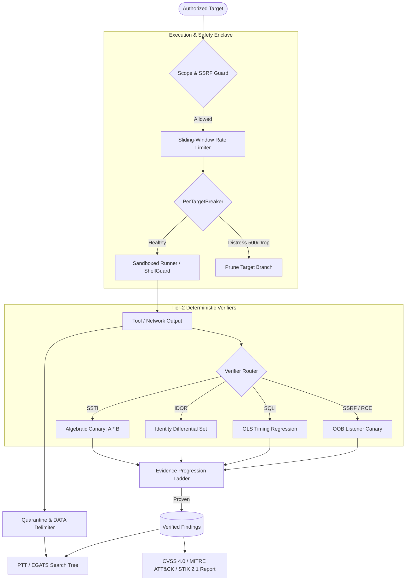

# PopperStrike

[](https://www.python.org/)
[](pyproject.toml)
[](https://github.com/jlowin/fastmcp)
[-brightgreen.svg)](tests/)
[](https://attack.mitre.org/)
[](#the-popperian-paradigm)
[](LICENSE)

> *"No matter how many instances of white swans we have observed, this does not justify the conclusion that all swans are white."*  
> — **Sir Karl Popper**, *The Logic of Scientific Discovery*

**PopperStrike** is an agentic offensive security and automated penetration testing framework built upon the philosophy of **Empirical Falsificationism**. 

Traditional AI security agents operate on naive confirmation bias — they trust generative LLMs to "evaluate" vulnerabilities, leading to rampant hallucinations, false positives, and context exhaustion. **PopperStrike** fundamentally changes the paradigm: it treats LLMs strictly as **untrusted hypothesis generators**. Every proposed vulnerability must endure deterministic mathematical refutation and empirical counter-proofs before it can be admitted to the audit record.

---

## The Popperian Paradigm: Zero-Hallucination Security

In classical epistemology, Karl Popper proved that empirical hypotheses can never be conclusively verified by accumulating supporting evidence; they can only be corroborated by **surviving rigorous, determined attempts at falsification**.

PopperStrike embeds this exact philosophy into automated red teaming:

```
┌────────────────────────────────────────────────────────┐
│ 1. Speculative Hypothesis (Untrusted LLM Reasoning)    │
│    "Target /api/v1/user may have Time-Based SQLi"      │
└──────────────────────────┬─────────────────────────────┘
                           │
                           ▼
┌────────────────────────────────────────────────────────┐
│ 2. The Falsification Crucible (Tier-2 Verifiers)       │
│    • Attempt to refute via OLS Linear Regression       │
│    • Stress-test with Algebraic Canary (A * B)         │
│    • Prove boundary counterfactuals & Negative Control │
└──────────────────────────┬─────────────────────────────┘
                           │
             ┌─────────────┴─────────────┐
             ▼                           ▼
    [Refuted / Hallucination]   [Survives Falsification]
    • Prune branch in EGATS     • Escalate on Evidence Ladder
    • Zero alert fatigue        • Corroborated Bug (E1 Certified)
```

---

## Architecture Overview

PopperStrike couples tree-search campaign planning (PTT/EGATS) with deterministic mathematical verification, an execution sandbox, and a native standard-library web scanner:

1. **Elimination of Hallucinations**: Speculative claims from LLMs are filtered through mathematical verification (OLS timing regression, algebraic canaries, differential identity sets) rather than prompt agreement.
2. **Context Window Decoupling**: Tactical state is recorded in an external graph structure (PTT), eliminating token degradation during long-horizon campaigns.
3. **Fail-Closed Safety Enclave**: Execution is quarantined by strict CIDR scope guards, tokenized command sanitizers, and target distress circuit breakers.



---

## Core Systems

### 1. Deterministic Tier-2 Verifiers (`verifiers.py`)
To prevent LLM hallucinations from entering audit reports, findings must pass rigorous mathematical and protocol-level tests:
* **Algebraic Canary (`AlgebraicCanaryVerifier`)**: Validates Server-Side Template Injection (SSTI) and expression execution. The verifier calculates random integer multiplications ($A \times B$). The finding is only marked valid if the calculated product appears in the response while the raw mathematical string is absent.
* **Identity Differential (`IdentityDifferentialVerifier`)**: Proves Broken Object-Level Authorization (IDOR/BOLA) by calculating token and data set differences between differing authorization contexts.
* **OLS Linear Regression (`LinearRegressionTimingVerifier`)**: Filters out network jitter in time-based blind SQL injection using Ordinary Least Squares regression across varying delay factors ($k$), confirming deliberate database sleep calls.
* **Out-of-Band Canary (`oob.py`)**: Deploys lightweight DNS and HTTP egress listeners to deterministically confirm blind SSRF and command injection.
* **Evidence Ladder (`evidence.py`)**: Transitions claims through structured stages (`Candidate` $\to$ `Adjudicated` $\to$ `Negative Control Clean` $\to$ `Confirmed`).

### 2. Penetration Testing Tree & EGATS (`brain.py`, `ptt.py`)
* **Stateful Campaign Memory**: Maintains all discovered hosts, services, parameters, and credentials in an external graph structure, completely independent of LLM context limits.
* **Exploitation Graph Attack Tree Search (EGATS)**: Explores attack vectors systematically, prioritizing high-yield tactics, pruning unproductive paths, and backtracking when branches fail.
* **Multi-Role Swarm Debate (`swarm.py`)**: Coordinates cross-examination between specialized agent roles (Reconnaissance Analyst, Web Auditor, Exploit Specialist) before committing nodes to the campaign tree.

### 3. Fail-Closed Safety Enclave
* **Filesystem Run Lock (`safety.py`)**: All CLI utilities halt immediately with exit code `3` if `agentpentest/RUN_DISABLED` is present.
* **SSRF & CIDR Scope Filter (`security.py`)**: Automatically drops out-of-scope targets and rejects private RFC-1918 ranges unless explicitly bypassed with `--allow-internal`.
* **Structured Argv Sanitization (`shellguard.py`)**: Enforces tokenized command vectors. Raw subshell execution (`bash -c`), pipes (`|`), and destructive commands (`rm`, `mkfs`, `dd`, `fdisk`) are strictly prohibited.
* **Target Health Circuit Breakers (`throttle.py`)**: Distinguishes target application failures (500/502/503 spikes, connection drops) from local runner errors, isolating and pruning unhealthy branches without halting the test.
* **Prompt Injection Quarantine (`security.py`)**: Encapsulates untrusted web and service output in structured `DATA|` blocks with automated regex heuristic screening to prevent prompt injection and steering.
* **Credential Vault (`asset_vault.py`)**: In-memory tokenization vault that replaces plaintext credentials with opaque tokens (e.g., `VAULT_REF:db_pass_1`) prior to LLM reasoning.

### 4. Native Standard-Library Scanners
The core engine runs with standard-library Python without requiring third-party package dependencies:
* **Web Security Scanner (`web_scanner.py`)**: Pure Python crawler, form/CSRF parser, reflected XSS tester, DOM XSS AST source-to-sink tracer, and tri-modal SQL injection analyzer (error-based, boolean-differential, and timing delta).
* **Attack Surface Management (`asm.py`)**: Certificate Transparency log aggregation (via crt.sh), DNS wildcard/brute-force enumeration, CDN edge fingerprinting, and asset drift tracking.
* **PCI DSS Segmentation Verifier (`segmentation.py`)**: Automated network segmentation verification matching PCI DSS v4.0 Requirement 11.4.5 criteria.

---

## CLI Reference

PopperStrike installs dedicated command-line utilities for modular workflows:

| Utility | Description | Source |
|---|---|---|
| `agentpentest` | Runs the full autonomous campaign pipeline (Simulation / Live) | [`agentpentest.campaign`](agentpentest/campaign.py) |
| `agentpentest-recon` | Phase-1 automated reconnaissance loop (subfinder, nmap, gobuster) | [`agentpentest.orchestrator`](agentpentest/orchestrator.py) |
| `agentpentest-web` | Native web attack surface mapper, XSS & tri-modal SQLi scanner | [`agentpentest.web_scanner`](agentpentest/web_scanner.py) |
| `agentpentest-asm` | Attack Surface Management: CT logs, DNS drift & CDN detection | [`agentpentest.asm`](agentpentest/asm.py) |
| `agentpentest-pci` | PCI DSS v4.0 Req 11.4.5 network segmentation verifier | [`agentpentest.segmentation`](agentpentest/segmentation.py) |
| `agentpentest-ui` | Local mission control dashboard (`http://127.0.0.1:8765`) | [`agentpentest.webui`](agentpentest/webui.py) |
| `agentpentest-view` | Visualizer and inspector for saved PTT graph trees & run logs | [`agentpentest.viewer`](agentpentest/viewer.py) |
| `agentpentest-lock` | Inspects or toggles the fail-closed run lock (`RUN_DISABLED`) | [`agentpentest.lock`](agentpentest/lock.py) |
| `agentpentest-audit` | Evaluates and scores campaign SQLite memory graphs | [`agentpentest.audit`](agentpentest/audit.py) |
| `agentpentest-report`| Generates CVSS 4.0, MITRE ATT&CK, and STIX 2.1 reports | [`agentpentest.postrun`](agentpentest/postrun.py) |

---

## Installation

### Requirements
* Python 3.11 or newer
* Linux (recommended for live tools like Nmap/Kali), macOS, or Windows (WSL2 recommended for live network tools)
* Optional: Docker (for isolated sandbox execution)
* Optional: Ollama (for self-hosted local model reasoning)

### Setup
```bash
# Clone the repository
git clone https://github.com/dbrian16/PopperStrike.git
cd PopperStrike

# Create a virtual environment
python -m venv .venv
source .venv/bin/activate  # On Windows: .venv\Scripts\activate

# Install core framework (zero dependencies, stdlib only)
pip install -e .

# Optional: Install FastMCP dependencies for Model Context Protocol integration
pip install -e ".[mcp]"
```

---

## Quickstart

### 1. Simulated Campaign (Zero Network Packets)
Evaluate the tree-search brain, multi-agent debate, and reporting engine offline without transmitting any network traffic:

```bash
# Run simulated campaign against an arbitrary target domain
agentpentest example.corp

# Operator-gated mode: approve each EGATS step interactively
agentpentest example.corp -i

# Save the PTT state tree and inspect it later
agentpentest example.corp --save campaign_tree.json
agentpentest-view tree campaign_tree.json

# Export structured JSON findings
agentpentest example.corp -o report.json
```

### 2. Native Web Application Scanner
Audit web applications for reflected XSS, DOM AST sinks, and tri-modal SQL injection:

```bash
# Scan target endpoint for vulnerabilities
agentpentest-web http://testphp.vulnweb.com/listproducts.php?cat=1

# Enable time-based blind SQLi detection (with OLS regression)
agentpentest-web http://testphp.vulnweb.com/listproducts.php?cat=1 --time-based

# Output structured JSON findings
agentpentest-web http://testphp.vulnweb.com/listproducts.php?cat=1 --json
```

### 3. Attack Surface Management (ASM)
Map domains, extract subdomains from Certificate Transparency logs, detect CDNs, and track infrastructure drift:

```bash
# Map attack surface
agentpentest-asm example.com

# Compare against historical snapshots to detect asset drift
agentpentest-asm example.com --history

# Output raw JSON
agentpentest-asm example.com --json
```

### 4. PCI DSS Network Segmentation Audit
Verify firewall isolation between Cardholder Data Environments (CDE) and non-CDE network segments:

```bash
# Run audit with reference enterprise segmentation architecture
agentpentest-pci --demo

# Export JSON audit report
agentpentest-pci --demo --json
```

### 5. Local Web Dashboard
PopperStrike includes an embedded, dependency-free dashboard served via `http.server`:

```bash
# Start local dashboard
agentpentest-ui

# Specify custom port without opening default browser
agentpentest-ui --port 9000 --no-browser
```
Access the control interface at `http://127.0.0.1:8765` to inspect active trees, review logs, and manage run lock states.

---

## Live Lab Deployments (Authorized Targets Only)

> [!WARNING]
> Live testing requires explicit, documented authorization. Never point PopperStrike at systems or networks without written permission and an agreed Rules of Engagement (RoE).

### 1. Disengage the Safety Run Lock
By default, live operations exit with code `3` if `agentpentest/RUN_DISABLED` is present.

```bash
# Check lock status
agentpentest-lock status

# Remove run lock for authorized testing
agentpentest-lock off

# Re-engage lock once testing concludes
agentpentest-lock on
```

### 2. Configure Reasoning Backend
PopperStrike defaults to local models via Ollama to prevent leaking sensitive target intelligence.

```bash
# Option A: Local Ollama (Recommended)
export AGENTPENTEST_OLLAMA_HOST=http://127.0.0.1:11434
export AGENTPENTEST_OLLAMA_MODEL=qwen2.5
ollama serve & ollama pull qwen2.5

# Option B: Cloud API (Explicit opt-in)
export AGENTPENTEST_LLM_PROVIDER=anthropic
export ANTHROPIC_API_KEY="your-api-key"
```

### 3. Run Autonomous Lab Engagements
Execute autonomous, human-in-the-loop workflows against authorized lab environments:

```bash
# Phase-1 live reconnaissance (Nmap, Subfinder, Gobuster inside sandbox)
agentpentest-recon 192.168.1.50 --scope 192.168.1.50 --allow-internal

# Autonomous terminal execution with operator confirmation
python deploy/live_autonomous.py 192.168.1.50 \
    --scope 192.168.1.50 \
    --allow-internal \
    --goal "Enumerate web services and verify authentication bypass" \
    --poc

# Full Co-RedTeam multi-agent loop
python deploy/live_autonomous.py 192.168.1.50 \
    --scope 192.168.1.50 \
    --allow-internal \
    --mode co-redteam
```

---

## Model Context Protocol (FastMCP)

PopperStrike implements the open **Model Context Protocol (MCP)**, allowing external AI agents (such as Claude Desktop or custom agents) to securely invoke its sandboxed tooling.

### Start the MCP Server
```bash
# Restrict MCP server to authorized target scope
python deploy/mcp_server.py --scope 192.168.1.50 --allow-internal
```

### Claude Desktop Integration
Add the following configuration to `claude_desktop_config.json`:

```json
{
  "mcpServers": {
    "pentagent": {
      "command": "python",
      "args": ["deploy/mcp_server.py", "--scope", "192.168.1.50", "--allow-internal"],
      "env": {
        "RECON_SCOPE": "192.168.1.50",
        "RECON_ALLOW_INTERNAL": "1",
        "RECON_ALLOW_SHELL": "1"
      }
    }
  }
}
```

Exposed MCP Tools:
* `subdomain_enum`: Passive subdomain discovery via `subfinder`.
* `port_scan`: Service and port fingerprinting via `nmap -sV`.
* `dir_fuzz`: Content and path discovery via `gobuster`.
* `web_vuln_scan`: Automated template scanning via `nuclei`.
* `run_command`: Controlled shell execution through ShellGuard validation.
* `run_poc`: Isolated execution of synthesized proof-of-concept scripts.

---

## Verification & Test Suite

The test suite covers deterministic verifiers, AST analysis, circuit breakers, rate limiters, and sandbox isolation:

```bash
# Run unit and regression tests
python -m pytest -q
```

```text
........................................................................ [ 14%]
........................................................................ [ 29%]
........................................................................ [ 44%]
........................................................................ [ 59%]
........................................................................ [ 74%]
........................................................................ [ 89%]
.....................................................                    [100%]
485 passed in 12.89s
```

All 485 tests run without external dependencies and validate:
* Mathematical canary calculation and OLS linear regression accuracy
* SSRF validation, CIDR containment, and ShellGuard argument checks
* Circuit breaker trip, reset, and per-target isolation logic
* OWASP CRS paranoia-level scoring and evasion planning
* Asset drift detection, Certificate Transparency parsing, and PCI segmentation logic
* Memory database serialization and SQLite audit integrity

---

## Legal & Ethical Disclaimer

PopperStrike is developed exclusively for authorized penetration testing, defensive security assessments, and academic research.

* Performing unauthorized security scans or exploitation against third-party systems without prior explicit written authorization is illegal and violates local, national, and international laws (including the US Computer Fraud and Abuse Act - 18 U.S.C. § 1030).
* The maintainers assume no liability and are not responsible for any misuse, unauthorized activity, or operational disruption caused by this software.
* Always define and strictly adhere to a signed Rules of Engagement (RoE) document prior to engaging targets.
